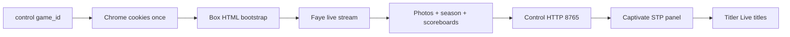

# Overview (plain language)

This project connects **live college basketball stats** from the NCAA website to **on-air graphics** in NewBlue Captivate / Titler Live.

Think of it as three cooperating parts:

```text
NCAA live box score  →  Stat scraper (this app)  →  NewBlue graphics
                              ↕
                     Operator control panel
```

## Who uses what

| Role | What they care about |
|------|----------------------|
| **Operator / producer** | Cue player bugs, take subs/timeouts/fouls, set foul hold time, turn Automatic Subs / Fouls on/off |
| **Graphics designer** | Link Captivate titles to `STP_NCAA_Basketball: Main` variables |
| **Engineer** | Keep the scraper running, fix parsers, add tests when features change |

## Startup → air (overall flow)



1. **Find / start** — pick today’s game (`find-games` or a known game id) and run `control --game-id …`.
2. **NCAA session** — soft cookies first; if the site still shows its access check, Chrome opens once, accepts terms, and leaves cookies in a shared jar. The box-score HTML bootstraps rosters and live keys; sport is detected as **WBB** or **MBB**.
3. **Live stream** — Faye connects for score, clock, on-court, plays, and shots. A quit-time snapshot restores period/clock/score/shots/lineups on restart (NCAA has no replay cursor).
4. **Enrich (parallel, after connect)** — roster photos into `~/SSC` when needed; team/coach season pages on the **same cookie jar**; scoreboard PNGs via SSC automation (teams that already exist in Title_Stuff are skipped).
5. **Control + Captivate** — HTTP on `127.0.0.1:8765`; the **STP NCAA Basketball** panel polls it and Link Data feeds Titler Live titles.
6. **On air** — auto or manual cues (player L3, subs, foul trouble, leaders, timeout, shot maps).

Day-of steps: [OPERATOR_GUIDE.md](OPERATOR_GUIDE.md). Data sources and session details: [STAT_SCRAPER.md](STAT_SCRAPER.md).

## Documents in this folder

| Doc | Read it if you want to… |
|-----|-------------------------|
| [OPERATOR_GUIDE.md](OPERATOR_GUIDE.md) | Run a game today (step-by-step) |
| [STAT_SCRAPER.md](STAT_SCRAPER.md) | Understand where stats come from |
| [NEWBLUE_CONTROLLER.md](NEWBLUE_CONTROLLER.md) | Understand the Captivate panel & variables |
| [GRAPHICS_REFERENCE.md](GRAPHICS_REFERENCE.md) | See each graphic and what it shows |
| [TESTING.md](TESTING.md) | Know how we keep features from breaking |
| [VERSIONING.md](VERSIONING.md) | Controller version numbers (Major.Minor.Patch) |

## What we intentionally skip (for now)

- A dedicated “scoring play” lower-third that announces every basket with assist text. That can be added later.
